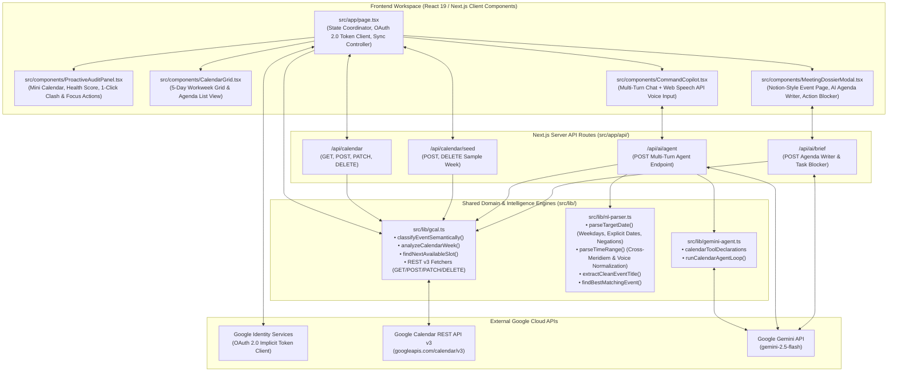
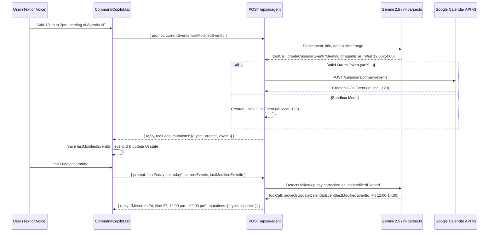

# System Architecture & Developer Guide (`ARCHITECTURE.md`)

This document explains the internal architecture, directory structure, data flow, AI execution pipeline, and extension points of **Google Calendar AI (Chronos)** so any engineer joining the project can understand and modify the codebase quickly.

---

## 1. High-Level System Architecture

The application is built as a full-stack **Next.js 15 (App Router)** TypeScript monorepo. It operates in a **Dual-Mode Execution Architecture**, meaning every action can mutate either the live **Google Calendar REST API v3** (when an OAuth 2.0 Bearer token `ya29...` is active) or the local reactive calendar state (in zero-setup Sandbox mode).



---

## 2. Directory & File Structure

```text
chronos-ai-calendar/
├── src/
│   ├── types/
│   │   └── calendar.ts                # Core TypeScript interfaces (GCalEvent, ScheduleAuditReport, etc.)
│   ├── lib/
│   │   ├── gcal.ts                    # Semantic classifier, conflict detector, slot finder & GCal REST v3 wrappers
│   │   ├── gemini-agent.ts            # Gemini 2.5 Flash Function Declarations & native tool-calling loop
│   │   ├── nl-parser.ts               # Deterministic natural language date/time/intent/context parser
│   │   └── demo-data.ts               # Initial Monday–Friday business week events for zero-setup Sandbox mode
│   ├── app/
│   │   ├── layout.tsx                 # Root HTML shell & metadata
│   │   ├── page.tsx                   # Main application controller, OAuth 2.0 handler & state coordinator
│   │   └── api/
│   │       ├── calendar/
│   │       │   ├── route.ts           # Proxy for live Google Calendar GET, POST, PATCH, DELETE
│   │       │   └── seed/route.ts      # 1-Click live Google Calendar sample week seeder & cleaner
│   │       └── ai/
│   │           ├── agent/route.ts     # Conversational & Voice AI Copilot execution engine
│   │           └── brief/route.ts     # Pre-meeting AI Agenda generator & Post-meeting Action Item blocker
│   └── components/
│       ├── ProactiveAuditPanel.tsx    # Left sidebar: Mini calendar, Health Score, Clash Resolver, Focus Blocks
│       ├── CalendarGrid.tsx           # Center view: 5-Day Workweek time grid (8 AM – 11 PM) & Agenda List view
│       ├── CommandCopilot.tsx         # Right sidebar: Chat UI, Web Speech API microphone & tool call receipts
│       ├── MeetingDossierModal.tsx    # Slide-over Event Page drawer: Properties, Agenda Writer & Task Blocker
│       └── CaseStudyModal.tsx         # Slide-over Product Strategy & Architecture modal
├── THOUGHT_PROCESS.md                 # Product & first-principles case study
├── ARCHITECTURE.md                    # Developer architecture & internals documentation
├── README.md                          # Quick-start and setup instructions
└── .env.example                       # Template for environment variables
```

---

## 3. Core Subsystems Explained

### 3.1. Semantic Classification & Schedule Health Engine (`src/lib/gcal.ts`)

Every raw event (`GCalEvent`) passes through `analyzeCalendarWeek(rawEvents, weekStartIso)` whenever the event list or active week changes:

1. **`classifyEventSemantically(event)`**:
   - Inspects the event summary, description, duration, and attendee count.
   - Assigns an `aiCategory` (`HIGH_ROI`, `DEEP_WORK`, `COLLABORATION`, `LOW_ROI_SYNC`), an `aiPriorityScore` (`1–100`), and an `aiEstimatedCost` (based on duration $\times$ attendees $\times$ loaded hourly rate).
2. **Pairwise Overlap Detection & Resolution**:
   - Sorts all timed events chronologically and checks for interval overlaps (`startA < endB && endA > startB`).
   - Marks both overlapping events with `hasConflict = true` and `conflictingWithIds`.
   - Compares `aiPriorityScore` between the two events to decide which event to **keep** (`keepEvent`) and which to **move** (`moveEvent`).
   - Calls `findNextAvailableSlot()` to compute the nearest conflict-free window of matching duration between `09:00` and `18:30` and emits a `ConflictResolutionSuggestion`.
3. **Focus Block Opportunity Scanner**:
   - Scans Monday through Friday for days that lack any `DEEP_WORK` event and finds open 2-hour morning slots (`09:00–17:30`) to recommend as `FocusBlockSuggestion` cards.
4. **Schedule Health Score (`0–100`)**:
   - Formula:
     $$\text{Score} = \text{clamp}_{12..98}\Big(65 + \min(25, 4.5 \times H_{\text{deep}}) - 14 \times N_{\text{conflicts}} - 7 \times N_{\text{fragmentedDays}} - 4 \times \max(0, H_{\text{lowRoi}} - 3)\Big)$$

---

### 3.2. Hybrid AI Agent Pipeline (`src/app/api/ai/agent/route.ts` & `src/lib/nl-parser.ts`)

Why use a **Hybrid (Gemini 2.5 Function Calling + Deterministic NL Parser)** architecture?
- **Reliability & Zero-Latency Fallback:** If a developer or reviewer runs the app without a `GEMINI_API_KEY` (or if API quota is exhausted), the deterministic NL parser (`src/lib/nl-parser.ts`) executes complex multi-turn commands in `< 15ms` with 100% reliability.
- **When `GEMINI_API_KEY` (`AIza...`) is provided:** The request runs through the native `@google/genai` multi-step tool loop (`while (response.functionCalls)`), calling:
  - `createCalendarEvent({ summary, startDateTime, endDateTime, description })`
  - `moveOrUpdateCalendarEvent({ eventId, newStartDateTime, newEndDateTime, newSummary, newDescription })`
  - `deleteCalendarEvent({ eventId, reason })`
  - `findOptimalFreeSlot({ preferredDateTimeIso, durationMinutes })`



#### Key Edge Cases Handled by `src/lib/nl-parser.ts`:
1. **Voice Speech-to-Text Dotted Meridiems:** Normalizes `"10:00 p.m."` and `"11:00 a.m."` to `"10:00 pm"` and `"11:00 am"`.
2. **Negated Dates:** Strips `"not today"`, `"not tomorrow"`, `"instead of Wednesday"` before resolving the target weekday so `"on Friday not today"` resolves strictly to Friday.
3. **Implicit Noon Crossing:** When a user says `"from 11 to 1 pm"`, the parser detects `startHour (11) > endHour (1)` with `startHour !== 12` and automatically assigns `11:00 AM – 1:00 PM` instead of `11:00 PM`.
4. **Contextual Multi-Turn Memory (`lastModifiedEventId`):**
   - Follow-up day edits (`"on Friday not today"`) preserve the previous event's exact start/end hours and move it to the new day.
   - Follow-up time edits (`"11pm to 12am"`, `"actually make it 2pm to 4pm"`) preserve the previous event's date and title and update its hours.
   - Follow-up renames (`"rename it to X"`) update `summary` in place.
   - Contextual pronoun deletions (`"delete it"`, `"remove that"`) target `lastModifiedEventId`.

---

### 3.3. Meeting Intelligence Pipeline (`src/app/api/ai/brief/route.ts`)

1. **`mode: "generate_agenda"`**:
   - Generates a structured 3-part agenda (`1. GOAL`, `2. TIMED AGENDA`, `3. KEY QUESTIONS TO ASK`).
   - If connected to live Google Calendar (`ya29...`), patches the event's `description` field directly via `PATCH /calendars/primary/events/{eventId}` and returns `updatedEvent`.
2. **`mode: "schedule_action_item"`**:
   - Takes raw post-meeting notes from the user, formats a concise task title (`"⚡ Follow-Up: ..."`), calls `findNextAvailableSlot()` for a 45-minute window after the meeting ends, and creates the follow-up event.

---

## 4. How to Extend the Codebase (For Future Developers)

### Adding a New AI Tool to the Copilot
1. **Declare the tool schema:** Add a new `FunctionDeclaration` object to `calendarToolDeclarations` in `src/lib/gemini-agent.ts`.
2. **Implement tool execution:** Add a handler branch inside `executeToolAction()` in `src/app/api/ai/agent/route.ts` that performs the Google Calendar API call (and returns a `CalendarMutationOp` so the frontend state updates immediately).
3. **Add deterministic fallback (optional):** Add a keyword/intent branch in `src/app/api/ai/agent/route.ts` so the tool also works offline without an API key.

### Adding a New Event Priority Category
1. Add the new category union member to `EventPriorityCategory` in `src/types/calendar.ts`.
2. Update `classifyEventSemantically()` in `src/lib/gcal.ts` with the classification rules and priority score.
3. Add the corresponding Notion pastel card style to `categoryStyles` and `categoryLabels` in `src/components/CalendarGrid.tsx`.
